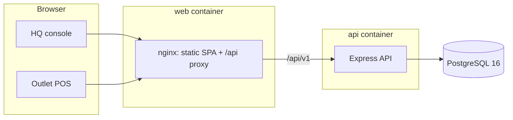
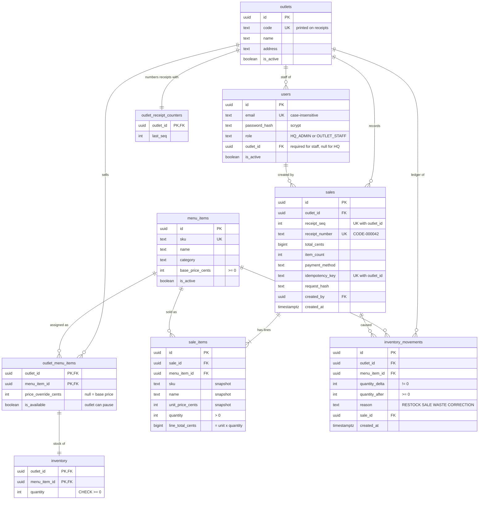
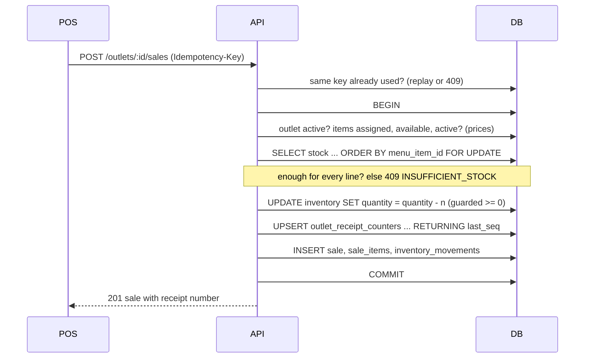
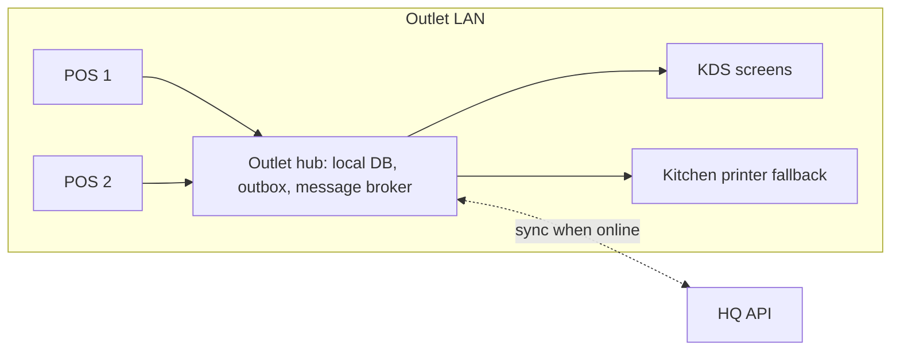

# Outlet HQ: architecture

This document explains how the system is built and how it would grow. It covers the schema (with an ERD), the main
flows, the scaling plan for 10 outlets and 100,000 transactions a month, a path to microservices, and how offline POS
terminals and the kitchen display (KDS) would keep working without internet.

- [1. System overview](#1-system-overview)
- [2. Backend structure](#2-backend-structure)
- [3. Data model and ERD](#3-data-model-and-erd)
- [4. Key flows](#4-key-flows)
- [5. Scaling plan: 10 outlets, 100,000 transactions a month](#5-scaling-plan-10-outlets-100000-transactions-a-month)
- [6. Evolving into microservices](#6-evolving-into-microservices)
- [7. Offline POS mode](#7-offline-pos-mode)

## 1. System overview



- **One company, many outlets.** HQ owns the master menu, assigns items to outlets (optionally at an outlet-specific
  price) and reads reports. Each outlet sees only its assigned items, keeps its own stock and records its own sales.
- **One API, one database** (a modular monolith). Every business rule that the database can enforce is a constraint,
  and every write that must be atomic is one transaction. This is the right shape for the current load (see section 5)
  and keeps the strongest guarantees cheap.
- **Same origin.** nginx serves the React build and forwards `/api` to the API, so the browser needs no CORS and the
  API is never exposed on a different host than the app.

## 2. Backend structure

```
backend/src
  config/env.ts         every setting, validated with zod at start-up (the process refuses a bad value)
  db/                   pool, withTransaction (retries deadlocks, sets lock/statement timeouts), migrations, seed
  lib/                  AppError classes, pg error mapping, shared zod schemas, logger
  middleware/           request id, validate (zod), authenticate / authorize / requireOutletAccess, error handler
  modules/<name>/       routes → controller → service → repository, one folder per business area
    auth  outlets  menu-items  outlet-menu  inventory  sales  reports
```

| Layer | Does | Never does |
|---|---|---|
| routes | paths, auth guards, `validate(schemas)` | logic |
| controllers | read validated input, call one service, shape the response | SQL, business rules |
| services | business rules, transactions | touch `req`/`res`, write SQL |
| repositories | SQL, parameterised, mapped to camelCase | decide transactions (they take a `Queryable`) |

**Errors** are thrown as typed `AppError`s with a stable `code` and turned into one response shape by one middleware:
`{ "error": { "code", "message", "details?", "requestId" } }`. Database errors a client can cause (unique, foreign
key, check) are mapped to 4xx as a safety net; anything else is a logged 500 with no internals in the body.

**Auth.** JWT (HS256, issuer and audience checked, 8 h by default). The user is re-read on every request, so a
deactivated user or outlet is refused immediately. Roles: `HQ_ADMIN` (everything) and `OUTLET_STAFF` (only their own
`outletId`, enforced on every `/outlets/:outletId/...` route). Passwords use scrypt (OWASP-equivalent parameters,
32 MiB) with a constant-time compare; login is rate-limited and answers the same for an unknown email and a wrong
password.

## 3. Data model and ERD



Design choices worth calling out:

| Choice | Why |
|---|---|
| Money in integer cents (`INTEGER` prices, `BIGINT` totals) | No floating-point rounding; totals are exact. One currency per deployment. |
| `outlet_menu_items` is the assignment and holds the override | "What an outlet sells, at what price" is one row; the effective price is `COALESCE(override, base)`. |
| `inventory` references `outlet_menu_items` | Stock can only exist for an assigned item; unassigning removes it. |
| `CHECK (quantity >= 0)` on stock | The last line of defence against overselling, even if application code is wrong. |
| Price, name and SKU snapshotted on `sale_items` | A receipt never changes when HQ edits the menu later. `CHECK (line_total = unit x qty)`. |
| `outlet_receipt_counters` (one row per outlet) | Sequential, gap-free receipt numbers per outlet under concurrency (section 4.1). |
| `inventory_movements` ledger | Every stock change is explainable and auditable; stock can be rebuilt from it. |
| `UNIQUE (outlet_id, idempotency_key)` | Safe retries and, later, safe offline sync (section 7). |
| UUID primary keys | Can be generated by clients and edge devices without coordination (offline mode). |

Indexes follow the queries: `sales (outlet_id, created_at DESC, id DESC)` for history and date ranges,
`sales (created_at)` for company-wide reports, `sale_items (sale_id, menu_item_id)` (from the unique constraint) for
lines, `sale_items (menu_item_id)`, `outlet_menu_items (menu_item_id)`, `inventory_movements (outlet_id, menu_item_id,
created_at DESC)`, unique indexes on `lower(email)`, `code`, `sku` and `receipt_number`.

## 4. Key flows

### 4.1 Recording a sale



- **No overselling.** Stock rows are locked before they are checked, so two sales cannot both see the last unit.
  The update is also guarded (`quantity + delta >= 0`) and the table has a `CHECK`.
- **No deadlocks.** Every transaction locks stock rows in `menu_item_id` order; two sales with the same items in
  opposite order wait for each other instead of deadlocking. `withTransaction` still retries a deadlock as a safety net.
- **Sequential, gap-free receipts.** The counter row is incremented inside the sale transaction. Its row lock
  serialises concurrent sales of one outlet, and a rolled-back sale also rolls back the increment, so no number is
  skipped. It is taken last, after the stock checks, to hold that lock as briefly as possible.
- **Server-side prices.** The client sends only items and quantities; the price comes from the outlet assignment at
  that moment and is stored on the line.
- **Retries are safe.** Same `Idempotency-Key` and same body: the original sale is returned (`200`,
  `Idempotent-Replayed: true`). Same key, different body: `409 IDEMPOTENCY_KEY_REUSED`. Two identical requests at once:
  the second hits the unique index, rolls back and returns the first.

Measured on a laptop (Docker, one outlet, 20 concurrent clients, three-line sales): about 180 sales per second,
p50 63 ms, p95 176 ms, every receipt number from 1 to 611 used exactly once. The integration tests check the same
properties on every run (40 parallel sales give 1..40; 30 parallel sales against 10 in stock give exactly 10).

### 4.2 Menu and stock

- HQ assigns an item to an outlet with `PUT /outlets/:outletId/menu-items/:menuItemId` (create or update, `201`/`200`)
  and can set or clear `priceOverrideCents`. The stock row is created at 0 in the same transaction.
- Staff can pause and resume an item (`PATCH ... { isAvailable }`) but cannot change its price.
- Stock changes (`RESTOCK`, `WASTE`, `CORRECTION`) lock the row, refuse to go below zero and write the ledger.

### 4.3 Reports

- **Revenue by outlet** aggregates `sales` per outlet for the range and joins every outlet, so an outlet with no sales
  shows 0.
- **Top items per outlet** aggregates `sale_items` joined to `sales`, ranks with
  `row_number() OVER (PARTITION BY outlet ORDER BY quantity DESC, revenue DESC, name, id)` and keeps the top N.
  Ties are deterministic.
- Ranges are `from` inclusive, `to` exclusive, ISO 8601 with a time zone; the web app sends local-day boundaries.

## 5. Scaling plan: 10 outlets, 100,000 transactions a month

**What the target means.** 100,000 sales a month is about 3,300 a day, about 330 per outlet a day. Over a 14-hour
trading day that averages 240 sales an hour, about 0.07 a second. Allowing for a lunch peak four times the average
and short bursts three times that, the peak is still under one sale a second across the company. Data grows by about
1.2 million sales, 3 million sale lines and 3 million ledger rows a year.

**Where we are.** One API instance and one Postgres already handle about 180 sales a second on a single outlet in
the test above, so the current design has roughly two orders of magnitude of headroom for this target. The plan is
therefore about reliability, report speed and room to grow, not raw throughput.

### 5.1 Database

| Step | When | What |
|---|---|---|
| Managed Postgres with a standby | Before going live | Automatic failover, daily snapshots and point-in-time recovery (WAL), tested restores. |
| Connection pooling | When API instances exceed ~4 | PgBouncer in transaction mode in front of Postgres; keep each API pool small. (Migrations use a session advisory lock, so they run on a direct connection.) |
| Watch the hot spots | From day one | Lock wait time on `inventory` and `outlet_receipt_counters`, slow queries (`pg_stat_statements`), autovacuum on `sales`, `sale_items`, `inventory_movements`. |
| Partition by month | Past ~50M sale lines | `sales`, `sale_items` and `inventory_movements` by `created_at` month; old partitions detached to cheaper storage. Not needed at 3M rows a year. |
| Read replica | When reports start to cost the primary | Route `/reports/*` and history lists to a replica; sales and stock stay on the primary. |
| Archive | After the legal retention period | Move closed years out of the hot tables. |

The per-outlet receipt counter is the one serialisation point by design (it is what makes numbers gap-free). It is
held for a few milliseconds per sale, which supports hundreds of sales a second per outlet. If an outlet ever needs
more, or terminals need to number receipts offline, number per terminal (`KLCC-T2-000123`), as in section 7.

### 5.2 Reporting

- **Now:** reports run live on indexed tables. At 3 million lines a year this stays fast.
- **Next:** a `daily_outlet_item_sales (outlet_id, menu_item_id, business_date, quantity, revenue_cents)` rollup,
  updated in the sale transaction with an upsert (or asynchronously from an outbox event). Reports then read days,
  not lines: revenue by outlet and top items become small scans regardless of history size.
- **Business date per outlet:** each outlet gets a time zone, so "today" and daily rollups follow its trading day.
- **Caching:** report responses for closed periods never change and can be cached; today's numbers can be cached for
  a short time (30 to 60 s).
- **Later:** stream changes (CDC, for example Debezium) into a warehouse (BigQuery, ClickHouse) for ad-hoc analytics,
  so analysts never query the transactional database.

### 5.3 Infrastructure

- The API is stateless: run two or more instances in different zones behind a load balancer, with health checks
  (`/health` liveness, `/ready` readiness), rolling deploys and autoscaling on CPU or p95 latency.
- Serve the web app from a CDN; it is static files.
- Move the per-instance login rate limit to a shared store (Redis) once there is more than one API instance.
- Secrets in a secret manager, not in environment files; TLS everywhere; database not reachable from the internet.
- Observability: the JSON logs already carry a request id end to end (nginx to API to error body); add metrics (sale
  latency, `INSUFFICIENT_STOCK` rate, lock waits, 5xx rate) and tracing (OpenTelemetry), with alerts on them.
- CI/CD: the pipeline already lints, type-checks, tests against Postgres and builds images; add a deploy step that
  runs migrations once before rolling out new API instances (migrations are additive so old and new code can overlap).

### 5.4 Architectural evolution

1. **Modular monolith (now).** Modules with clear boundaries, one transaction where atomicity matters.
2. **Separate the read side.** Rollups and report endpoints read from a replica or a reporting store.
3. **Events.** A transactional outbox table written in the same transaction as a sale or stock change (`SaleCompleted`,
   `StockAdjusted`, `MenuAssigned`), published to a broker. Consumers update rollups, send notifications and feed
   the offline outlet hubs.
4. **Extract services** only where a team or a scaling need justifies it (section 6).

## 6. Evolving into microservices

Microservices are worth it when separate teams need to release independently or parts of the system scale very
differently. At 10 outlets neither is true yet, so the modular monolith is the better choice today. The module
boundaries are already drawn along the lines the services would follow.

| Service | Owns | Why separate |
|---|---|---|
| Identity | users, roles, tokens | Shared by every other service and by future apps; changes on its own schedule. |
| Catalog and assignment | master menu, outlet assignments, outlet prices | HQ-facing, read-heavy, cacheable; publishes `MenuPublished` for outlets and offline hubs. |
| Sales and inventory | sales, receipt counters, stock, the ledger | The one place that needs strong consistency: a sale and its stock deduction must commit together. Kept as one service so that stays a local transaction. |
| Reporting | rollups, report queries | Read-only, built from events; can use a different store and scale on its own. |
| Outlet sync gateway | device registration, offline sync | Talks to outlet hubs (section 7); isolates flaky edge connectivity from the core. |
| Notifications (later) | low-stock alerts, daily summaries | Purely event-driven. |

Principles:

- **Each service owns its data.** No service reads another's tables; they use APIs or events.
- **Keep the strongly consistent part together.** Splitting sales and inventory would turn one transaction into a
  saga (reserve stock, record sale, confirm or compensate), adding failure modes for no gain at this size. If they
  must split later, use stock reservations with expiry and compensations.
- **Events through a transactional outbox** (write the event in the same transaction as the change, publish after
  commit), at-least-once delivery, idempotent consumers keyed by event id.
- **An API gateway** in front for authentication, rate limits and routing; services trust a verified identity token.
- **Price snapshots** stay on sale lines, so Sales never needs Catalog to explain a past receipt.

## 7. Offline POS mode

Outlets lose internet. Selling and the kitchen must keep working, and nothing may be lost or counted twice when the
connection returns.

### 7.1 An outlet hub on the local network

Each outlet runs a small **outlet hub**: a mini PC or one designated POS, on the outlet's LAN, with a local database
(SQLite or Postgres). POS terminals and KDS screens talk to the hub over the LAN, so they work the same with or
without internet. The hub talks to HQ when it can.



### 7.2 Selling offline

- **The hub records the sale locally,** in one local transaction: check and deduct local stock, take the next receipt
  number, write the sale and an **outbox** entry. Ids are UUIDs (v7 for time order), generated locally.
- **Receipt numbers stay sequential per outlet** because the hub is the outlet's single numbering authority while
  offline: it holds the counter. HQ accepts the numbers the hub assigned (still unique per outlet). Without a hub,
  terminals number per terminal (`KLCC-T2-000123`) so two terminals can never collide.
- **Stock** is per outlet, and only that outlet sells it, so the hub can be the authority for sale deductions while
  offline. HQ's adjustments (restock, waste) are sent as **deltas**, which commute, so no update is lost when both
  sides changed stock.
- **Prices and menu** come from the last menu version the hub received (HQ pushes `MenuPublished` with a version).
  Each offline sale carries its line prices and the menu version used; HQ records those prices, because that is what
  the customer paid.

### 7.3 Syncing when the internet returns

1. The hub sends outbox entries in order, each with its **Idempotency-Key** (the API already supports this: a retry
   returns the original sale, a conflicting reuse is refused).
2. HQ acknowledges up to a watermark; the hub deletes acknowledged entries. Delivery is at least once; the
   idempotency key makes it exactly once in effect.
3. HQ sends down what changed while the hub was offline: menu versions, price changes, stock adjustments made at HQ.
4. **Conflicts:**
   - A sale that already happened is never rejected. If merging an HQ adjustment would take stock below zero, HQ
     records the sale, books a `CORRECTION` to zero and raises a reconciliation alert for a person to check (a sync
     endpoint would do this instead of the `409` the live endpoint returns).
   - Availability flags: last writer wins, with timestamps.
   - Price changes made at HQ during the outage apply to sales after the hub receives them.
5. **Time:** each record stores the device time and the time HQ received it; large clock skew is flagged.

### 7.4 POS and KDS without internet

- The hub runs a small message broker (MQTT, for example Mosquitto) or a WebSocket hub. POS terminals publish
  `order.created`; KDS screens subscribe, acknowledge, and publish `order.ready`. Everything stays on the LAN.
- Messages are persisted on the hub and retried until acknowledged, so a KDS that restarts gets its open tickets back.
- Devices find the hub by a fixed address or mDNS. If the hub itself fails, POS terminals fall back to printing
  kitchen tickets on a local printer and queue their sales for the hub (or for HQ) when it returns.

### 7.5 Security offline

- The local database is encrypted at rest; each hub and terminal is registered with its own credential (device
  token or mTLS certificate) that HQ can revoke.
- Staff sign in offline with a PIN checked against hashes the hub cached while online; the hub limits how long it
  accepts offline sign-ins (for example 72 hours) before it must reach HQ.
